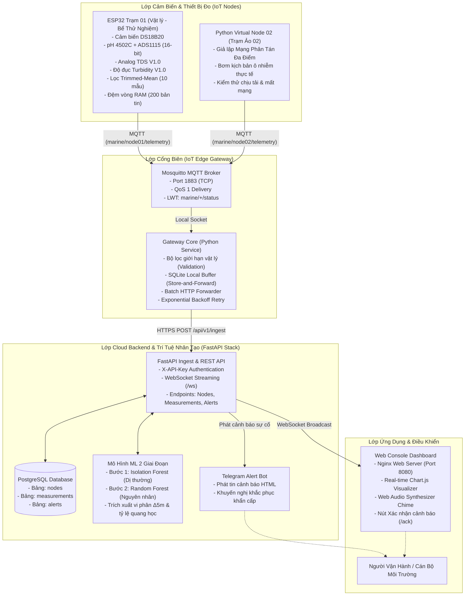
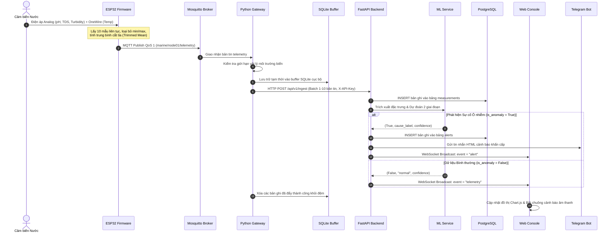

# Kiến Trúc Hệ Thống Giám Sát Ô Nhiễm Nước Biển Ven Bờ

## 1. Tổng Quan Hệ Thống

Hệ thống được thiết kế theo mô hình **IoT 3 lớp hoàn chỉnh** (3-Tier IoT Architecture), đáp ứng nghiêm ngặt các tiêu chí của đồ án môn học:
- **Lớp Thiết bị đo (IoT Sensing Nodes):** Thu thập dữ liệu chất lượng nước đa thông số theo thời gian thực tại các tọa độ phân tán.
- **Lớp Cổng giao tiếp biên (IoT Edge Gateway):** Cầu nối trung chuyển dữ liệu giữa mạng cảm biến cục bộ và mạng diện rộng, tích hợp bộ đệm ngoại tuyến (Store-and-Forward) và xác thực gói tin.
- **Lớp Điện toán Đám mây & Ứng dụng (Cloud Backend, ML & Dashboard):** Tiếp nhận dữ liệu tập trung, lưu trữ cơ sở dữ liệu quan hệ, suy luận AI/ML 2 giai đoạn (phát hiện bất thường và phân loại nguyên nhân nghi ngờ), phát cảnh báo tức thời qua Telegram và hiển thị bảng điều khiển trực quan.

---

## 2. Luồng Xử Lý Dữ Liệu Chi Tiết (Data Flow Sequence)

---

## 3. Đặc Tả Từng Phân Hệ

### 3.1. Phân hệ IoT Sensing Node (Phần Cứng & Firmware)
- **Vi điều khiển:** ESP32-WROOM-32 (Dual-core 240MHz, tích hợp Wi-Fi 802.11 b/g/n, Bluetooth LE, 520KB SRAM).
- **Bộ chuyển đổi ADC chuyên dụng:** ADS1115 (16-bit Sigma-Delta ADC, giao tiếp I2C qua chân GPIO21/22):
  - *Lý do sử dụng:* Khắc phục hoàn toàn nhược điểm phi tuyến tính nghiêm trọng và nhiễu sóng của ADC nội bộ ESP32. Cho phép cấu hình dải điện áp linh hoạt $\pm 4.096\text{V}$, an toàn tuyệt đối cho ESP32 khi kết nối các cảm biến 5V.
- **Hệ cảm biến phân tích nước:**
  1. *Nhiệt độ nước:* DS18B20 chống nước (vỏ inox, giao tiếp số OneWire qua GPIO4, độ chính xác $\pm 0.5^\circ\text{C}$).
  2. *Độ pH:* Cảm biến pH 4502C kết hợp điện cực BNC gel không sạc lại ("Không thể sạc lại", kênh A0 trên ADS1115).
  3. *Tổng chất rắn hòa tan / Độ mặn:* TDS Meter V1.0 (kênh A1 trên ADS1115, dải đầu ra $0 - 2.3\text{V}$, tích hợp bù nhiệt tự động).
  4. *Độ đục quang học:* Turbidity Sensor V1.0 (kênh A2 trên ADS1115, phát hiện hạt lơ lửng và bùn phù sa).
  5. *Màu sắc quang học:* GY-33 / TCS34725 (giao tiếp I2C, đo cường độ R-G-B phục vụ nhận diện tảo đỏ/xanh).
- **Thuật toán xử lý tín hiệu tại biên (Edge DSP):**
  - **Lọc trung vị cắt tỉa (Trimmed-Mean Filter):** Lấy 10 mẫu điện áp liên tiếp trong 200ms, sắp xếp tăng dần, loại bỏ 2 giá trị cực đại và 2 giá trị cực tiểu, lấy trung bình 6 mẫu ở giữa. Triệt tiêu 99% xung nhiễu điện áp do bọt sóng và rung lắc.
  - **Bù nhiệt độ động (Dynamic Temperature Compensation):** Bù trôi nhiệt cho phép đo pH (theo phương trình Nernst) và TDS (hệ số bù $2\%/^\circ\text{C}$).
  - **Bộ đệm vòng RAM (Circular Buffer):** Dung lượng 200 bản ghi trong RAM. Khi mất sóng Wi-Fi hoặc mất kết nối MQTT, firmware tự động chuyển sang chế độ Store-and-Forward; ngay khi có mạng trở lại, đệm được xả dần lên broker mà không làm nghẽn socket.
  - **MQTT LWT (Last Will & Testament):** Tự động đăng ký bản tin `marine/{node_id}/status = {"status":"offline"}` có cờ `retained=True`. Nếu trạm bị mất nguồn hoặc đứt cáp, broker tự động thông báo ngay lập tức.

---

### 3.2. Phân hệ IoT Edge Gateway
- **Nền tảng thực thi:** Dịch vụ Python 3.12 chạy thường trú trên máy tính biên / Raspberry Pi / Docker Container, đi kèm Mosquitto MQTT Broker.
- **Kiểm định dữ liệu biên (Physical Bounds Validation):**
  - Trước khi ghi đệm, gateway kiểm tra tính toàn vẹn của JSON và đối chiếu với các ngưỡng vật lý tự nhiên của môi trường nước biển:
    - Nhiệt độ: $-10^\circ\text{C} \le T \le 60^\circ\text{C}$
    - pH: $0.0 \le \text{pH} \le 14.0$
    - TDS: $0 \le \text{TDS} \le 50,000\text{ ppm}$
    - Độ đục: $0 \le \text{Turbidity} \le 2,000\text{ NTU}$
  - Các gói tin lỗi do tuột dây cảm biến hoặc tràn dữ liệu được gắn cờ cảnh báo và từ chối chuyển tiếp để tránh gây nhiễu cơ sở dữ liệu Cloud.
- **Cơ chế chịu lỗi Store-and-Forward (Persistent SQLite Buffer):**
  - Sử dụng cơ sở dữ liệu SQLite cục bộ được bảo vệ bởi khóa đồng bộ `threading.Lock`.
  - Mọi bản tin hợp lệ được lưu bền vững vào bảng `telemetry_buffer` trước khi gửi đi.
  - Khi Cloud bị sự cố hoặc đứt cáp internet quốc tế, dữ liệu được tích lũy an toàn lên tới 5,000 bản ghi.
  - Sau khi Cloud hồi phục, gateway thực hiện gửi bù theo lô (batch size = 10) kết hợp thuật toán **Exponential Backoff** ($2^n$ giây) để không làm quá tải máy chủ tiếp nhận.

---

### 3.3. Phân hệ Điện Toán Đám Mây & Trí Tuệ Nhân Tạo (Cloud Backend & ML)
- **Framework nền tảng:** FastAPI (Python 3.12, xử lý bất đồng bộ AsyncIO, hiệu năng cao).
- **Cơ sở dữ liệu:** PostgreSQL 16 (với chỉ mục B-tree trên các cột `node_id`, `ts`, `cause`, `acknowledged`).
- **Pipeline Trí tuệ nhân tạo 2 giai đoạn (Two-Stage Machine Learning Engine):**
  - **Giai đoạn 1 - Phát hiện dị thường không giám sát (Isolation Forest):**
    - Sử dụng 150 cây quyết định độc lập trên không gian đặc trưng đã được chuẩn hóa `RobustScaler`.
    - Tách biệt ngay lập tức các mẫu bất thường có mật độ phân bố dị biệt mà không cần định trước ngưỡng cứng.
  - **Giai đoạn 2 - Phân loại nguyên nhân ô nhiễm (Random Forest Classifier):**
    - Sử dụng 120 cây quyết định, phân loại chính xác 5 trạng thái:
      1. `normal`: Nước biển bình thường theo chu kỳ thủy triều và ngày đêm.
      2. `acidic_industrial`: Xả thải hóa chất axit công nghiệp (pH tụt dốc, ion hòa tan tăng).
      3. `domestic_sewage`: Nước thải sinh hoạt hữu cơ (độ đục tăng vọt, TDS biến động, nhiệt độ tăng).
      4. `algal_bloom`: Hiện tượng tảo nở hoa / thủy triều đỏ (quang hợp rút CO2 làm pH kiềm hóa $>8.8$, sắc tố diệp lục tăng vọt).
      5. `runoff_sediment`: Nước lũ sau mưa cuốn phù sa (nước ngọt pha loãng làm TDS tụt mạnh, độ đục $>150\text{ NTU}$, màu nâu đất).
  - **Kỹ thuật trích xuất đặc trưng vật lý - môi trường:**
    - Mã hóa chu kỳ thời gian 24h: $\sin(2\pi \cdot \text{hour}/24)$ và $\cos(2\pi \cdot \text{hour}/24)$.
    - Tốc độ biến thiên vi phân $\Delta 5\text{m}$: $\Delta \text{pH}_{5\text{m}}, \Delta \text{TDS}_{5\text{m}}, \Delta \text{Turb}_{5\text{m}}, \Delta T_{5\text{m}}$.
    - Độ lệch chuẩn động trong 15 phút: $\sigma_{15\text{m}}(\text{pH}), \sigma_{15\text{m}}(\text{Turb})$.
    - Tỷ số quang học và hóa lý: $G/R, B/R, \text{Turb}/\text{TDS}$.

---

### 3.4. Phân hệ Web Console & Cảnh Báo Telegram
- **Web Console Dashboard:**
  - Thiết kế Dark-Mode phong cách đại dương hiện đại, thân thiện với màn hình điều hành NOC.
  - 4 biểu đồ đường Chart.js cập nhật trực tiếp theo thời gian thực (Real-time Streaming) qua kết nối WebSocket song công.
  - Bảng tổng hợp KPI (Trạng thái trạm, Gói tin tiếp nhận, Chỉ số chất lượng trung bình, Số lượng cảnh báo chưa xác nhận).
  - Tích hợp bộ tạo âm thanh cảnh báo sử dụng **Web Audio API** (không cần tải file âm thanh ngoài, chạy mượt trên mọi trình duyệt).
  - Cho phép người vận hành ấn nút **Xác nhận sự cố (/ack)** trực tiếp trên giao diện để ghi nhận xử lý vào database.
- **Telegram Alert Bot:**
  - Định dạng tin nhắn HTML trực quan với biểu tượng màu sắc tương ứng mức độ nghiêm trọng:
    - 🔴 **Khẩn cấp (Axit công nghiệp / Tảo độc):** Cảnh báo lập tức cho đội kiểm tra nguồn xả.
    - 🟠 **Cảnh báo (Nước thải sinh hoạt):** Gửi tọa độ và tỷ lệ tin cậy của mô hình ML.
    - 🟡 **Lưu ý (Phù sa sau mưa):** Thông báo trạng thái đục tự nhiên do dòng chảy.
