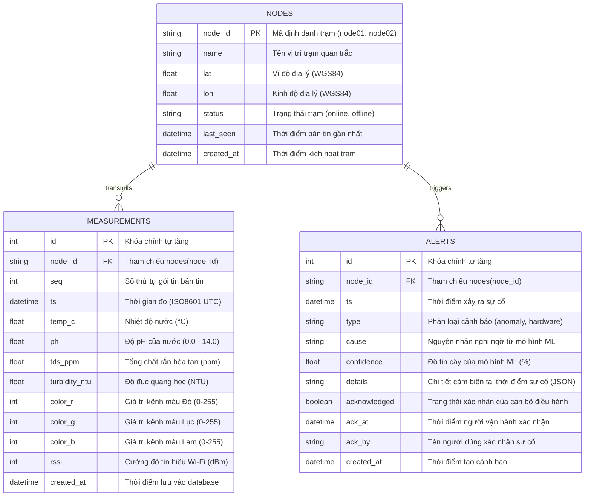

# Lược Đồ Cơ Sở Dữ Liệu & Định Dạng Bản Tin (Data Schema)

Hệ thống sử dụng cơ sở dữ liệu quan hệ **PostgreSQL 16** (kèm tương thích SQLite cho kiểm thử cục bộ) quản lý thông qua ORM SQLAlchemy.

---

## 1. Sơ Đồ Thực Thể - Mối Quan Hệ (ER Diagram)

---

## 2. Chi Tiết Cấu Trúc Các Bảng

### 2.1. Bảng `nodes` (Danh Mục Trạm Quan Trắc)
| Tên Cột | Kiểu Dữ Liệu | Ràng Buộc | Mô Tả |
|---|---|---|---|
| `node_id` | `VARCHAR(32)` | **PRIMARY KEY**, NOT NULL | Mã định danh duy nhất (VD: `node01`) |
| `name` | `VARCHAR(128)` | NOT NULL | Tên trạm hiển thị trực quan |
| `lat` | `DOUBLE PRECISION` | NULLABLE | Vĩ độ địa lý trạm (VD: `16.0748`) |
| `lon` | `DOUBLE PRECISION` | NULLABLE | Kinh độ địa lý trạm (VD: `108.2441`) |
| `status` | `VARCHAR(16)` | DEFAULT `'offline'` | Trạng thái kết nối (`online`, `offline`) |
| `last_seen` | `TIMESTAMP WITH TIME ZONE` | NULLABLE | Cập nhật mỗi khi có bản tin mới |
| `created_at` | `TIMESTAMP WITH TIME ZONE` | DEFAULT `NOW()` | Thời gian khởi tạo trạm |

### 2.2. Bảng `measurements` (Chuỗi Dữ Liệu Đo Đạc)
| Tên Cột | Kiểu Dữ Liệu | Ràng Buộc | Mô Tả |
|---|---|---|---|
| `id` | `BIGSERIAL` | **PRIMARY KEY**, NOT NULL | Khóa chính tự tăng |
| `node_id` | `VARCHAR(32)` | **FOREIGN KEY** (`nodes.node_id`) | Trạm thực hiện phép đo |
| `seq` | `INTEGER` | NULLABLE | Số thứ tự tăng dần từ firmware |
| `ts` | `TIMESTAMP WITH TIME ZONE` | NOT NULL, **INDEX** | Mốc thời gian đo đạc (UTC) |
| `temp_c` | `REAL` | NOT NULL | Nhiệt độ nước ($\pm 0.5^\circ\text{C}$) |
| `ph` | `REAL` | NOT NULL | Chỉ số pH ($0.0 - 14.0$) |
| `tds_ppm` | `REAL` | NOT NULL | Tổng chất rắn hòa tan ($\text{ppm}$) |
| `turbidity_ntu` | `REAL` | NOT NULL | Độ đục quang học ($\text{NTU}$) |
| `color_r` | `SMALLINT` | DEFAULT `0` | Cường độ màu Đỏ ($0-255$) |
| `color_g` | `SMALLINT` | DEFAULT `0` | Cường độ màu Lục ($0-255$) |
| `color_b` | `SMALLINT` | DEFAULT `0` | Cường độ màu Lam ($0-255$) |
| `rssi` | `SMALLINT` | DEFAULT `-60` | Cường độ tín hiệu Wi-Fi ($\text{dBm}$) |
| `created_at` | `TIMESTAMP WITH TIME ZONE` | DEFAULT `NOW()` | Thời gian ghi nhận tại máy chủ |

*Chỉ mục tối ưu hóa truy vấn:*
- `ix_measurements_node_id_ts`: Phục vụ truy vấn dữ liệu chuỗi thời gian cho đồ thị Web Console (`WHERE node_id = ? AND ts >= ? ORDER BY ts ASC`).

### 2.3. Bảng `alerts` (Sự Cố & Cảnh Báo Ô Nhiễm)
| Tên Cột | Kiểu Dữ Liệu | Ràng Buộc | Mô Tả |
|---|---|---|---|
| `id` | `BIGSERIAL` | **PRIMARY KEY**, NOT NULL | Khóa chính tự tăng |
| `node_id` | `VARCHAR(32)` | **FOREIGN KEY** (`nodes.node_id`) | Trạm phát hiện sự cố |
| `ts` | `TIMESTAMP WITH TIME ZONE` | NOT NULL, **INDEX** | Thời điểm xảy ra sự kiện ô nhiễm |
| `type` | `VARCHAR(32)` | DEFAULT `'anomaly'` | Loại sự kiện (`anomaly`, `sensor_error`) |
| `cause` | `VARCHAR(64)` | NOT NULL, **INDEX** | Nhãn nguyên nhân từ mô hình ML |
| `confidence` | `REAL` | NOT NULL | Độ tin cậy suy luận ($0 - 100\%$) |
| `details` | `TEXT` | NULLABLE | Snapshot thông số cảm biến dạng JSON |
| `acknowledged` | `BOOLEAN` | DEFAULT `FALSE`, **INDEX** | Cán bộ đã ấn xác nhận hay chưa |
| `ack_at` | `TIMESTAMP WITH TIME ZONE` | NULLABLE | Thời điểm cán bộ xác nhận |
| `ack_by` | `VARCHAR(64)` | NULLABLE | Người ký nhận xử lý sự cố |
| `created_at` | `TIMESTAMP WITH TIME ZONE` | DEFAULT `NOW()` | Thời gian tạo bản ghi cảnh báo |

---

## 3. Danh Mục Nhãn Nguyên Nhân (Pollution Causes)

| Nhãn (`cause`) | Mức Độ | Tên Tiếng Việt | Dấu Hiệu Nhận Biết |
|---|:---:|---|---|
| `normal` | An toàn | Nước biển bình thường | Dao động nhiệt độ & pH theo nhật triều, độ đục $< 10\text{ NTU}$ |
| `acidic_industrial` | 🔴 Khẩn cấp | Nước thải axit công nghiệp | $\text{pH} < 5.0$, ion hóa chất làm tăng nhẹ TDS, nhiệt độ tăng nhẹ |
| `domestic_sewage` | 🟠 Cảnh báo | Nước thải sinh hoạt | Độ đục tăng vọt ($40-100\text{ NTU}$), TDS tăng, nhiệt độ ấm hơn |
| `algal_bloom` | 🔴 Khẩn cấp | Tảo nở hoa / Thủy triều đỏ | $\text{pH} > 8.8$ do tảo rút $\text{CO}_2$, độ đục tăng, màu xanh lục đậm |
| `runoff_sediment` | 🟡 Lưu ý | Nước lũ phù sa sau mưa | Độ đục cực đại ($>150\text{ NTU}$), TDS tụt sâu do nước ngọt pha loãng |
