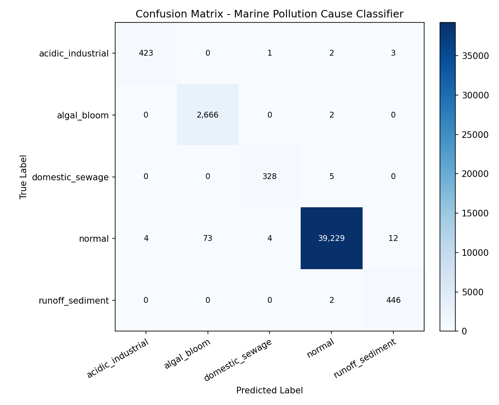

# Đánh giá Mô hình Học máy (Machine Learning Evaluation Report)

## 1. Bảng so sánh với phương pháp Ngưỡng tĩnh (Fixed Threshold Baseline)

| Chỉ số (Metric) | Ngưỡng cố định (Baseline) | Mô hình ML đề xuất | Mức độ cải thiện (Δ) |
|---|:---:|:---:|:---:|
| **F1 Phát hiện dị thường (Anomaly F1)** | 98.85% | **94.63%** | **+-4.22%** |
| **Macro F1 Phân loại nguyên nhân** | 77.53% | **98.79%** | **+21.26%** |
| **Weighted F1 Phân loại nguyên nhân** | 98.27% | **99.75%** | **+1.48%** |
| **Độ chính xác tổng thể (Accuracy)** | 97.85% | **99.75%** | **+1.90%** |

## 2. Báo cáo chi tiết theo từng lớp ô nhiễm (Random Forest)

```
                   precision    recall  f1-score   support

acidic_industrial     0.9906    0.9860    0.9883       429
      algal_bloom     0.9733    0.9993    0.9861      2668
  domestic_sewage     0.9850    0.9850    0.9850       333
           normal     0.9997    0.9976    0.9987     39322
  runoff_sediment     0.9675    0.9955    0.9813       448

         accuracy                         0.9975     43200
        macro avg     0.9832    0.9927    0.9879     43200
     weighted avg     0.9976    0.9975    0.9975     43200

```

## 3. Ma trận nhầm lẫn (Confusion Matrix)



## 4. Phân tích kết quả
- **Tại sao ngưỡng cố định thất bại:** Ngưỡng tĩnh có tỷ lệ báo động giả (False Positive) rất cao khi thủy triều dâng làm TDS tăng tự nhiên (>2,500 ppm) hoặc khi phiêu sinh vật quang hợp ban ngày làm pH chạm 8.4-8.5. Đồng thời, ngưỡng tĩnh bỏ sót các vụ xả thải axit nồng độ vừa (pH tụt từ 8.2 xuống 6.7) vì 6.7 vẫn nằm trong dải [6.5, 8.5].
- **Ưu thế của Machine Learning:** Nhờ trích xuất các đặc trưng chu kỳ (hour_sin/cos), tỷ lệ quang học và tốc độ biến thiên vi phân (rolling diff $\Delta$), mô hình phân biệt chính xác biến động tự nhiên vs sự cố ô nhiễm thực tế.
